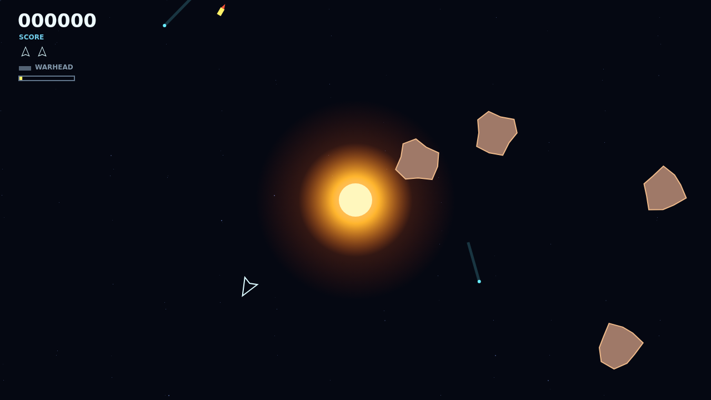

# Shatter

Shatter drops you into a wrapping deep-space arena where every shot has to contend with a blazing gravity well. Your ship flies on pure momentum, but the star bends bullets and rocks into dangerous, useful curves.

Large rocks wear heavy armor. Chip it away, shatter each body into smaller fragments, and clear every last shard to reach a faster, denser wave. Anything swallowed by the star returns from the edge, keeping the field in motion.

The enemy saucer arrives to hunt you between volleys. When ordinary fire cannot break a rock in time, launch your Warhead: one guided torpedo that flies true through the well and destroys any rock outright, followed by a tense ten-second recharge.

Learn the well, bend impossible shots, and keep the field under control.
